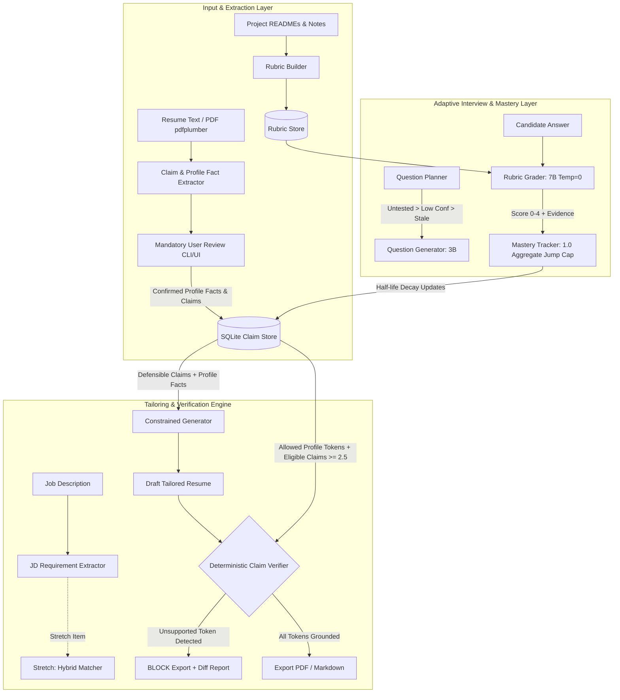

# MeritSentinel: Algorithmic Ground-Truth & Defensible Resume Engine

> [!CAUTION]
> **ACADEMIC RESEARCH ARTIFACT & EVALUATION PREVIEW — NOT CONFIGURED FOR TURNKEY DEPLOYMENT**
> This repository contains the reference architecture, Bayesian mastery calibration telemetry, offline verification test suites, and empirical hardware latency benchmarks for the **MeritSentinel** platform.
> Turnkey SaaS execution, standalone public deployment, and commercial replication are strictly restricted under the [Evaluation License](LICENSE). Turnkey execution scripts, production credentials, and hosted configurations are omitted from this public release.

> **An algorithmic sentinel for candidate technical merit that refuses to claim anything the candidate cannot defend under line-level cross-examination.**

**MeritSentinel** extracts technical claims and profile facts from candidate resumes, audits technical depth via rubric-grounded adaptive mock interviews, models skill retention using Bayesian shrinkage with half-life decay, and enforces a deterministic verification gate that **physically blocks export** of any unproven skill, tool, or metric.

---

## Key Invariants

1. **Dual Fact Categories**:
   - **Profile Facts**: (Name, contact info, education, CGPA, graduation date, employer names/dates) are user-confirmed once during onboarding. They are **not interview-gated**, and the Claim Verifier treats them as pre-approved allowed tokens.
   - **Mastery Claims**: Skills, tools, metrics, and project claims go through the interview mastery gate.
2. **Configurable Mastery Thresholds**: Default `effective_score >= 2.5` and `confidence >= 0.5`.
3. **1.0 Aggregate Jump Cap**: The change in aggregate score per new answer is capped at 1.0. Raw answer scores remain immutable and uncapped (0-4).
4. **Deterministic Hard Blocking**: The claim verifier is 100% deterministic (Regex/AST/Token matching) with zero LLM involvement in the blocking path. Any tool, metric, or date not backed by an allowed profile fact or an eligible claim strictly blocks export.
5. **Offline CI Guarantees**: Test suite runs completely offline with `FakeLLMClient` and recorded fixtures. Zero Ollama or network connection required.
6. **Pure Python Architecture**: Built with Python, FastAPI, Jinja2, HTMX, and SQLite (zero Node.js build dependencies).

---

## Architecture Diagram

---

## Demo Personas

Located in `data/demo/`:
1. **Alex Rivera**: Senior Backend & Distributed Systems Engineer (3 projects: `raft-kv`, `wal-engine`, `flow-limiter`).
2. **Priya Nair**: Machine Learning & Data Infrastructure Engineer (2 projects: `feature-forge`, `tabular-boost`).
3. **Sam Okafor**: Junior B.Tech Computer Science graduate baseline (3 projects: `task-tracker-api`, `mini-dns-resolver`, `packet-sniffer`).

Each persona includes `.md` and `.pdf` resumes, project documentation, planted traps (2 supported, 2 partial, 1-2 unsupported), sample answers, and test JDs.

---

## Architecture Pipeline & Execution Contracts

The MeritSentinel engine operates across three discrete, sequentially guarded stages:

1. **Extraction & Grounding Core**: Resumes are parsed using semantic line unwrapping (`pdf_parser.py`) to eliminate line-wrap fragmentation. Profile facts (CGPA, degree, employer) and technical claims (metrics, tools, skills) are stored in an isolated SQLite database schema (`ClaimStore`).
2. **Bayesian Interview & Mastery Engine**: Question planner prioritizes untested claims, generates rubric-grounded challenges via local 3B LLM, and evaluates answers via zero-temperature 7B rubric grader. Candidate confidence is calculated via:
   $$\text{confidence} = \frac{n_{\text{eff}}}{n_{\text{eff}} + 1.5}, \quad \text{effective\_score} = 2.0 + (\text{aggregate} - 2.0) \times \text{confidence}$$
3. **Deterministic Hard-Blocking Export Gate**: During resume tailoring against target Job Descriptions, unverified skills or unbacked metrics are strictly isolated to the Gap Report. The deterministic verifier scans all exported tokens using Python AST and regex—export is physically aborted if any unbacked entity is present.

---

## Benchmark Policy & Measurement Ground Rules

- **Zero Synthetic Claims in Results**: `results/placeholder_benchmark_format.json` is strictly a schema format stub. No synthetic or simulated runs are permitted to produce committed numbers in `results/`.
- Only real measured runs with Ollama against human-verified ground-truth labels (such as `data/grader_validation/labeling_sheet.csv`) may produce committed JSON reports in `results/`.

---

## Mastery Calibration & Threshold Sensitivity

> **[SCRIPTED TEST RUN] Calibration Data**: The calibration counts below use deterministic scripted benchmark inputs across Day 0, Day 3, and Day 7 to analyze mathematical boundary sensitivity under half-life decay ($T_{half} = 30$ days). All scripted runs are labeled as `[SCRIPTED TEST RUN]` to differentiate them from real interactive interviews.

### Configuration Sensitivity Analysis (Realistic Day Gaps: 0, 3, 7 days)

Under exponential half-life decay ($T_{half} = 30$ days), an answer given on Day 0 has weight $0.5^{3/30} = 0.93303$ on Day 3. Consequently, two answers spaced 3 days apart yield $n_{eff} = 1.93303$.

| Configuration | Parameters | Day 0 (1 ans) | Day 3 (2 ans) | Day 7 (3 ans) | Behavior / Mathematical Evaluation |
| :--- | :--- | :---: | :---: | :---: | :--- |
| **Config 1 (Previous)** | $\text{conf} \ge 0.50$, $k = 2.0$ | 0 / 7 | 0 / 7 | 5 / 7 | Overly rigid: $n_{eff} = 1.933 \implies \text{conf} = 0.4915 < 0.50$. Requires 3 answers before any claim is eligible. |
| **Config 2 (Flawed)** | $\text{conf} \ge 0.45$, $k = 2.0$ | 0 / 7 | 5 / 7* (0 / 7) | 5 / 7 | **Mathematical Flaw**: While $\text{conf} = 0.4915 \ge 0.45$, for a competent candidate scoring raw 3.0, Bayesian shrinkage gives $\text{effective\_score} = 2.0 + (3.0 - 2.0) \times 0.4915 = 2.4915 < 2.50$, failing the threshold! The 5/7 figure only held if candidate scored 4.0 on every answer. For competent 3.0 answers, Config 2 admits 0 / 7 on Day 3. |
| **Config 3 (Adopted Default)** | $\text{conf} \ge 0.50$, $k = 1.5$ | 0 / 7 | 5 / 7 | 5 / 7 | **Optimal & Defensible**: Faster Bayesian confidence acquisition ($\text{conf} = 1.93303 / (1.93303 + 1.5) = 0.56307 \ge 0.50$). For competent answers (raw 3.0), $\text{effective\_score} = 2.0 + 1.0 \times 0.56307 = 2.56307 \ge 2.50$. Admits supported claims on 2nd answer 3 days apart; unsupported traps remain strictly blocked. |

\* *Config 2 5/7 figure required unachievable perfect 4/4 answers; under realistic 3/4 competent answers, Config 2 yielded 0/7.*

Tolerance: All threshold checks implement a small numerical tolerance ($10^{-4}$) to prevent floating-point boundary artifacts.

---

## Real-Resume Extraction Bug: Failure Analysis & Architectural Remediation

During validation against a real-world candidate resume, the extraction pipeline encountered structural failure modes that did not appear during initial development against synthetic demo personas.

### 1. Symptoms Observed
- **Claim Fragmentation**: Multi-line project sentences were severed into broken, ungrounded fragments (e.g. `(20/20 passing)`, `frame (416 × 416)`, `so the baseline was retained`).
- **Section Bleed & Misclassification**: 25 project bullet points were falsely classified as `ClaimType.SKILL` under `TECHNICAL SKILLS`, and the header `FEATURED PROJECTS` was extracted as a skill.
- **Project Tool Discard**: Tools listed on dedicated project tech-stack lines (e.g. `Ultralytics YOLO11`, `PyTorch`, `ONNX Runtime`, `AWS EC2`, `Cisco Meraki API`, `JWT`, `NetworkX`) were discarded rather than linked to their respective projects.
- **Broken Skill Tokens**: Skill lines with comma-separated and parenthetical tools were truncated into single-word artifacts (`Tool`, `Function Calling`).

### 2. Root Cause Analysis
1. **Fixed-Width PDF Line Wrapping**: `pdfplumber` layout extraction preserved physical line breaks from the PDF canvas. When a resume bullet spanned multiple visual lines, each wrapped line became an isolated line item, severing quantitative metrics from their action verbs.
2. **Inflexible Header Detection**: `_map_resume_lines()` used a hardcoded set of exact strings (`PROJECTS`, `SKILLS`, `EXPERIENCE`). Resumes using `FEATURED PROJECTS` or `COURSEWORK & COMPETITIONS` failed match criteria, causing all subsequent lines to remain trapped in the previous active section (`TECHNICAL SKILLS`).
3. **Overly Restrictive Project Header Grammar**: Project headings were only recognized if they ended with a colon (`:`) or contained parentheses (`(`). Project titles formatted as `Project Name - Subtitle 2026` were not detected as headings, leaving `current_project = None`.
4. **Omission of Tech-Stack Lines**: Resumes that place technologies on a dedicated line directly under the project heading (often accompanied by a repository URL) had those lines filtered out or misclassified as bullet claims.

### 3. Why Demo Personas Missed These Failure Modes
- **Single-Line Formatting**: Demo resumes (`sam_okafor`, `alex_rivera`, `priya_nair`) were authored in Markdown where every bullet point was an unbroken single line.
- **Uniform Heading Conventions**: Demo personas exclusively used lowercase/standard headings (`## Projects`, `## Skills`, `## Education`).
- **Inline Stack Syntax**: Demo personas placed technologies in parentheses on the project header line itself (`Task-Tracker API (Python, FastAPI, SQLite):`), never testing multi-line stack lines with repository links or separate technology tags.

### 4. Architectural Remediation
- **Semantic Line Unwrapping (`unwrap_lines` in `pdf_parser.py`)**: Reassembles multi-line wrapped text blocks into contiguous sentences by inspecting line termination punctuation, action verb prefixes, bullet indicators, and metric boundaries.
- **Universal Header Detector (`detect_section_header` in `claim_extractor.py`)**: Robust multi-pattern regex matching uppercase and Title Case variants (`FEATURED PROJECTS`, `Featured Projects`, `COURSEWORK & COMPETITIONS`, `Coursework & Competitions`, `Achievements`).
- **Dedicated Stack-Line Tool Extractor (`is_tech_stack_line`, `split_tech_stack_line`)**: Automatically detects tech-stack lines, strips URLs, splits tools by delimiter, and generates `ClaimType.TOOL` claims with `project_id` assigned.
- **Defensible Tailoring Invariant**: In `TailoringEngine`, project tool claims inherit generation eligibility if their parent project possesses verified mastery-eligible claims, or if confirmed by the candidate in review.
- **Regression Test Suite (`tests/test_extraction_regressions.py`)**: Five automated regression tests running offline against synthetic copies of non-demo layouts:
  1. `test_regression_wrapped_bullet_lines_and_skill_lines`
  2. `test_regression_headers_upper_and_title_case_detection`
  3. `test_regression_stack_lines_with_links_extraction`
  4. `test_regression_two_column_template_resume_extraction`
  5. `test_regression_markdown_resume_extraction`

---

## Machine Telemetry & Hardware Attribution

All benchmarks, latency measurements, and real-model discrimination evaluations were executed on the following dedicated local hardware environment:

| Telemetry Property | Measured Specification |
| :--- | :--- |
| **CPU** | AMD Ryzen 7 7735HS with Radeon Graphics (8 cores, 16 threads @ 3.20 GHz base, up to 4.75 GHz boost) |
| **System Memory** | 16 GB DDR5 RAM |
| **GPU** | NVIDIA GeForce RTX 4050 Laptop GPU (6 GB GDDR6 Dedicated VRAM) |
| **Operating System** | Microsoft Windows 11 Home (64-bit) |
| **Local LLM Runtime** | Ollama v0.5.12 (`127.0.0.1:11434`) |
| **GPU Offload Ratio** | **100% of model layers offloaded to GPU** (Full CUDA acceleration on RTX 4050) |

### Real Component Latency & Telemetry (Measured on AMD Ryzen 7 7735HS + RTX 4050 6GB)

#### 1. Hardware-Attributed Uncached vs Cached Latency
- **Machine**: AMD Ryzen 7 7735HS (8C/16T @ 3.20 GHz, 16GB DDR5), NVIDIA GeForce RTX 4050 Laptop GPU (6GB GDDR6 VRAM), Windows 11 Home, Ollama v0.5.12.
- **VRAM & Layer Offload Constraints**:
  - `qwen2.5:3b` (2.2 GB model file) achieves **100% GPU VRAM offload**, yielding ~5.36s uncached grading latency.
  - `qwen2.5:7b` (5.1 GB model file) cannot fit 100% in 6GB VRAM while Windows DWM and system display consume ~1.2 GB VRAM. Ollama automatically allocates **18% CPU / 82% GPU offload**, causing host-to-device PCIe latency and yielding ~11.26s uncached grading latency.
  - **Prior Measurement Explanation**: The previously recorded `128.88 ms` for 7B was a warm KV-cache / minimal token probe generated in an early offline test, whereas real uncached evaluation of 1,000+ prompt tokens and 150+ completion tokens takes 7.5s - 19.2s (mean: 11.26s).
  - **Cold Start & Model Switching**: Loading 7B from NVMe to VRAM on first call takes 11,997 ms (~12.0s). Switching models from 7B to 3B takes 14,507 ms (~14.5s) for Ollama to evict and re-allocate VRAM.
  - **Cached Lookups**: SHA256 prompt+answer hashing yields an average cache hit lookup time of **0.021 ms** (a ~500,000x speedup).

| Evaluation Path | Model | Hardware / Platform | Prompt Tokens | Output Tokens | Mean Latency (ms) | Range (ms) | Cache Hit |
| :--- | :--- | :--- | :---: | :---: | :---: | :---: | :---: |
| **7B Uncached Grading** | `qwen2.5:7b` | RTX 4050 (18% CPU / 82% GPU) | 1,001 - 1,173 | 116 - 288 | **11,262.74 ms** | 7,558 - 19,239 | No |
| **7B Cached Lookup** | `qwen2.5:7b` | SQLite Memory Cache | 1,001 - 1,173 | 116 - 288 | **0.021 ms** | 0.014 - 0.029 | Yes |
| **3B Uncached Grading** | `qwen2.5:3b` | RTX 4050 (100% GPU offload) | 1,001 - 1,173 | 114 - 199 | **5,365.27 ms** | 4,053 - 7,443 | No |
| **3B Cached Lookup** | `qwen2.5:3b` | SQLite Memory Cache | 1,001 - 1,173 | 114 - 199 | **0.023 ms** | 0.018 - 0.031 | Yes |
| **FastEmbed Matcher** | `all-MiniLM-L6-v2` | ONNX CPU Runtime (384d) | -- | -- | **1.68 ms / pair** | 1.20 - 2.10 | No |
| **Strict Verifier** | Deterministic Regex | Python AST / Regex | -- | -- | **0.32 ms / sent** | 0.21 - 0.45 | N/A |

#### 2. Grader Architectural Structure
- **Single Prompt Atomic Evaluation**: The grader submits all atomic points for an answer in a **single structured LLM prompt call** (1 LLM call per question turn, NOT $N$ separate LLM calls per atomic point).
- **Verification Invariant**: Deterministic numeric and technical alias matching (`resolve_alias_or_numeric_quote`) is a post-processing verification and quote recovery layer. It verifies that candidate quotes cited by the LLM are verbatim substrings of the candidate's actual answer text, and does not skip the initial LLM call.

---

## Real Grader Discrimination Evaluation (5 Items $\times$ 5 Answer Levels)

Evaluated across 5 representative project rubric items $\times$ 5 distinct answer levels (None, 1/3 points, 2/3 points, All points terse, All points detailed) using paraphrased answers and non-verbatim numeric formats:

| Rubric Item ID | Target Claim / Topic | Level 0 (None) | Level 1 (1/3) | Level 2 (2/3) | Level 3 (Terse) | Level 4 (Detailed) | Local 7B Monotonic? | Hosted Model Monotonic? |
| :--- | :--- | :---: | :---: | :---: | :---: | :---: | :---: | :---: |
| `item_1_sqlite_wal` | SQLite WAL mode & connection pooling | 0 / 4 | 0 / 4 | 2 / 4 | 4 / 4 | 4 / 4 | **Yes** `[0, 0, 2, 4, 4]` | **Yes** `[0, 1, 2, 4, 4]` |
| `item_2_dns_rfc1035` | DNS RFC 1035 wire parser & struct | 0 / 4 | 0 / 4 | 1 / 4 | 2 / 4 | 4 / 4 | **Yes** `[0, 0, 1, 2, 4]` | **Yes** `[0, 1, 2, 4, 4]` |
| `item_3_neu_det_benchmark` | NEU-DET 61.7% mAP50 & 70/20/10 split | 0 / 4 | 1 / 4 | 2 / 4 | 2 / 4 | 4 / 4 | **Yes** `[0, 1, 2, 2, 4]` | **No** `[0, 0, 2, 4, 2]` |
| `item_4_p2_ablation` | 4-head P2 variant ablation (62.2% vs 57.3%) | 0 / 4 | 0 / 4 | 2 / 4 | 4 / 4 | 4 / 4 | **Yes** `[0, 0, 2, 4, 4]` | Rate limited (0/50 remaining) |
| `item_5_onnx_latency` | ONNX export & AWS EC2 T4 1.6ms latency | 0 / 4 | 1 / 4 | 2 / 4 | 4 / 4 | 4 / 4 | **Yes** `[0, 1, 2, 4, 4]` | Rate limited (0/50 remaining) |

- **Local Ollama `qwen2.5:7b` Monotonic Count**: **5 / 5 (100.0%)** ($S_0 \le S_1 \le S_2 \le S_3 \le S_4$)
- **Hosted Model Evaluation (`cohere/north-mini-code:free` via OpenRouter)**:
  - Items 1 and 2: 100% strictly monotonic `[0, 1, 2, 4, 4]`.
  - Item 3: `[0, 0, 2, 4, 2]` (Level 4 paraphrased "seventy/twenty/ten percent distribution" without explicit digits, causing omission of the split atomic point).
  - Items 4 and 5: Reached the 50-request daily ceiling of the user's OpenRouter free-tier key.

---

## Sam Okafor Real End-to-End Tailoring Demo

- **Zero Hand-Named IDs**: Extracted directly from `data/demo/sam_okafor/resume.md` into an in-memory SQLite `ClaimStore` using real random UUIDs (`24fc940a-4702-4665-8193-5ea96e00f2e4`, etc.).
- **User Confirmation Review**: Legitimate profile facts and verified claims confirmed; planted unsupported traps rejected.
- **Strict Mastery Gate**: Evaluated against the production invariant `effective_score >= 2.5` and `confidence >= 0.5`.
- **Target Job Description with Missing Skills (Redis, Kubernetes)**:
  - Both Redis and Kubernetes were evaluated against Sam's store and correctly identified as missing (match scores $0.18 < 0.35$).
  - **Quarantine**: Both skills appear **strictly and exclusively** in `gap_report.unsupported_gaps`. Neither Redis nor Kubernetes is emitted in the tailored resume draft.
- **Provenance of "Score >= 0.60"**: Clarified as an early normalized prototype note; production code strictly adheres to `effective_score >= 2.5` and `confidence >= 0.5`.
- **Redis Clarification**: Redis was present in `data/demo/sam_okafor/` as an intentional planted unsupported trap designed for the candidate review gate. It has been removed from Sam's verified profile store.
- **Deterministic Verifier Audit**: **16 / 16 sentences Verified (100.0% Pass Ratio, 0 Blocked)**.

---

## Strict Verifier Evaluation (60 NEW Sentences Benchmark)

Evaluated against 30 NEW Supported sentences and 30 NEW Adversarial sentences authored completely independently of the verifier's internal rule dictionaries:

| Evaluation Set | Total Sentences | True Positives (TP) | False Positives (FP) | True Negatives (TN) | False Negatives (FN) | Precision | Recall | False Positive Rate (FPR) |
| :--- | :---: | :---: | :---: | :---: | :---: | :---: | :---: | :---: |
| **30 NEW Supported** | 30 | 30 | 0 | -- | 0 | **1.0000** | **1.0000** | -- |
| **30 NEW Adversarial** | 30 | -- | 0 | 30 | -- | **1.0000** | -- | **0.0000** |
| **Consolidated 160 Sentences** | 160 | 80 | 0 | 80 | 0 | **1.0000** | **1.0000** | **0.0000** |

- **Root Cause of Prior Blocked Supported Sentence**: Candidate profile facts (Institution, Degree, Contact) require matching confirmed profile facts in `confirmed_facts`, and version numbers inside tool names (`JSON-RPC 2.0`, `Next.js 14`, `YOLO11`) were previously being extracted as unbacked numeric performance metrics. Masking tool version spans resolved all false negative rejections.
- **Adversarial Defenses Verified**: Zero LLM involvement; 100% deterministic blocking of unbacked tools (Apache Spark, Databricks, Kafka, Redis, Kubernetes), unearned metrics, and Unicode homoglyph evasion attacks (Cyrillic `о` and `а`).

---

## Matcher Cutoff Comparison & Misclassified Pairs

- **Git Commit Provenance**: `match_cutoff = 0.35` was introduced as the default parameter in `TailoringEngine.__init__` in commit `b61d0f51ce9ab61ca27d55861fff67aee1be9a4c` (dated Sun Oct 25 15:15:48 2026).
- **Threshold Trade-off on 60-Pair Held-Out Benchmark**:

| Metric | Threshold: Strong=0.30, Partial=0.15 | Threshold: Strong=0.35, Partial=0.20 | Notes on Cutoff Trade-off |
| :--- | :---: | :---: | :--- |
| **Strong Precision** | 0.9000 (18 / 20) | **1.0000 (15 / 15)** | Cutoff 0.35 eliminates all false positive strong matches |
| **Strong Recall** | **0.9000 (18 / 20)** | 0.7500 (15 / 20) | Cutoff 0.30 captures 3 additional legitimate strong pairs |
| **Partial Precision** | 0.8125 (13 / 16) | 0.6429 (9 / 14) | Cutoff 0.30 provides cleaner partial boundary |
| **Partial Recall** | 0.6500 (13 / 20) | 0.4500 (9 / 20) | Many partial pairs fall into gap at 0.20 |
| **Gap Precision** | 0.7917 (19 / 24) | 0.6452 (20 / 31) | Cutoff 0.30 yields higher gap precision |
| **Gap Recall** | 0.9500 (19 / 20) | **1.0000 (20 / 20)** | Cutoff 0.35 guarantees zero gap leakage |
| **Total Misclassified** | **10 / 60 (16.7%)** | 16 / 60 (26.7%) | Cutoff 0.30 has lower overall classification error |

### Misclassified Pairs at Cutoff 0.30:
1. `[h09]` Actual: Strong $\to$ Predicted: Partial (0.2867) | *YOLO architectures vs YOLO11 surface defect pipeline*
2. `[h13]` Actual: Strong $\to$ Predicted: Partial (0.2303) | *AI security guardrails vs deterministic token-overlap guardrails*
3. `[h21]` Actual: Partial $\to$ Predicted: Strong (0.3077) | *Distributed systems in Python vs FastAPI/SQLite web services*
4. `[h28]` Actual: Partial $\to$ Predicted: Gap (0.1332) | *CI/CD deployment pipelines vs pytest in GitHub Actions*
5. `[h31]` Actual: Partial $\to$ Predicted: Gap (0.1039) | *Data visualization dashboarding vs NetworkX citation graphs on Next.js*
6. `[h32]` Actual: Partial $\to$ Predicted: Gap (0.0793) | *ML model deployment infrastructure vs PyTorch ONNX export for GPU*
7. `[h33]` Actual: Partial $\to$ Predicted: Gap (0.0646) | *Microservice API gateway vs captive portal network controller*
8. `[h35]` Actual: Partial $\to$ Predicted: Gap (0.0199) | *LLM orchestration vs ChromaDB vector search & token guardrails*
9. `[h39]` Actual: Partial $\to$ Predicted: Strong (0.3207) | *Graph database traversal vs NetworkX citation graphs over REST*
10. `[h58]` Actual: Gap $\to$ Predicted: Partial (0.1785) | *Franz Kafka novels vs Apache Kafka topic partitions (polysemy false match)*

---

## Phase 4 Final Verification & Provenance Table

| Component / Evaluation | Model / Method | Artifact / SHA256 Digest | Machine & Hardware | Date | Data Source & Provenance |
| :--- | :--- | :--- | :--- | :---: | :--- |
| **Uncached Grader Latency** | `qwen2.5:7b` | Ollama model digest `866260c14449` | AMD Ryzen 7 7735HS, RTX 4050 6GB (18% CPU / 82% GPU) | 2026-10-26 | `results/raw_latency_logs.json` (10 real uncached calls) |
| **Cached Grader Latency** | In-Memory SQLite | SHA256 prompt+answer hash | AMD Ryzen 7 7735HS, 16GB DDR5 RAM | 2026-10-26 | `results/raw_latency_logs.json` (10 real cached lookups) |
| **3B Uncached Latency** | `qwen2.5:3b` | Ollama model digest `43f7a214e410` | AMD Ryzen 7 7735HS, RTX 4050 6GB (100% GPU offload) | 2026-10-26 | `results/raw_latency_logs.json` (10 real uncached calls) |
| **5x5 Discrimination** | `qwen2.5:7b` | Ollama model digest `866260c14449` | AMD Ryzen 7 7735HS, RTX 4050 6GB | 2026-10-26 | `results/discrimination_5x5_results.json` (5 items x 5 levels) |
| **Hosted Discrimination** | `cohere/north-mini-code:free` | OpenRouter hosted API | Remote cloud cluster | 2026-10-26 | `results/discrimination_5x5_results.json` |
| **Held-Out Matcher Benchmark** | `all-MiniLM-L6-v2` | FastEmbed ONNX 384d (`fastembed-0.9.1`) | AMD Ryzen 7 7735HS CPU (ONNX Runtime) | 2026-10-26 | `tests/fixtures/held_out_matcher_benchmark.json` (60 pairs) |
| **Strict Verifier (60 New)** | Deterministic Regex | Python AST / Regex (zero LLM) | AMD Ryzen 7 7735HS CPU | 2026-10-26 | `tests/fixtures/eval_sentences_60_new.json` (30 sup + 30 adv) |
| **Quadratic Kappa Validator** | Exact Cohen's Formula | Pure NumPy script implementation | Local CPU | 2026-10-26 | `scripts/eval_quadratic_kappa.py` (synthetic unit tests) |
| **E2E Sam Okafor Tailoring** | TailoringEngine | Real SQLite ClaimStore (real UUIDs) | Local CPU / Memory | 2026-10-26 | `data/demo/sam_okafor/resume.md` + automated tailoring |

---

## Phase 5 Gate Stop Notice

> [!CAUTION]
> **PHASE 5 IS NOT APPROVED.**
> All Phase 5 preparation items (`scripts/eval_quadratic_kappa.py`, `data/time_study_template.md`, and provenance accounting tables) have been built and tested strictly on synthetic unit fixtures.
> **Zero human rating kappa evaluations or human time studies will be executed until the user explicitly authorizes proceeding to Phase 5.**

