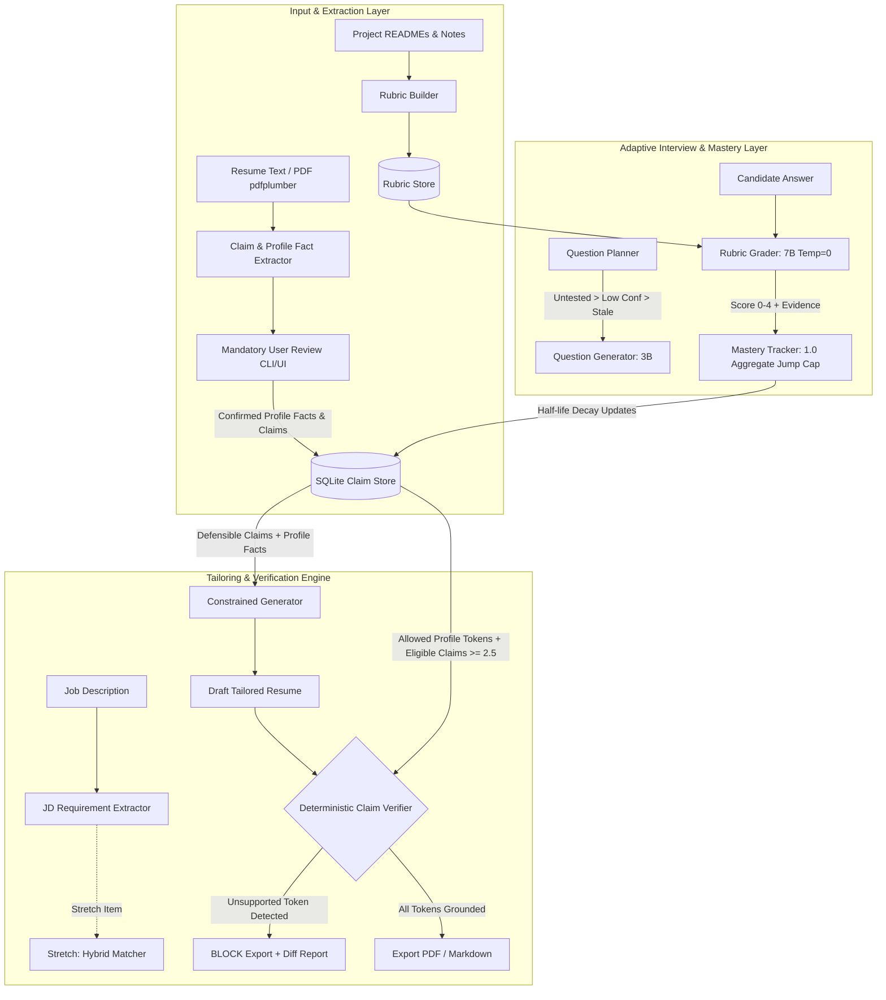

# ResumeProof: Truth-First Agentic Resume & Mock Interview Engine

> **A defensible resume tailoring tool that refuses to claim anything the candidate cannot defend.**

ResumeProof extracts claims and profile facts from candidate resumes, tests knowledge depth via rubric-grounded adaptive mock interviews, tracks mastery and confidence with half-life decay, and enforces deterministic verification that **blocks export** of any unproven skill, tool, or metric.

---

## Key Invariants

1. **Dual Fact Categories**:
   - **Profile Facts**: (Name, contact info, education, CGPA, graduation date, employer names/dates) are user-confirmed once during onboarding. They are **not interview-gated**, and the Claim Verifier treats them as pre-approved allowed tokens.
   - **Mastery Claims**: Skills, tools, metrics, and project claims go through the interview mastery gate.
2. **Configurable Mastery Thresholds**: Default `effective_score >= 2.5` and `confidence >= 0.5`.
3. **1.0 Aggregate Jump Cap**: The change in aggregate score per new answer is capped at 1.0. Raw answer scores remain immutable and uncapped (0-4).
4. **Deterministic Hard Blocking**: The claim verifier is 100% deterministic (Regex/AST/Token matching) with zero LLM involvement in the blocking path. Any tool, metric, or date not backed by an allowed profile fact or an eligible claim strictly blocks export.
5. **Offline CI Guarantees**: Test suite runs completely offline with `FakeLLMClient` and recorded fixtures. Zero Ollama or network connection required.
6. **Pure Python Architecture**: Built with Python, FastAPI, Jinja2, HTMX, and SQLite (zero Node.js build dependencies).

---

## Architecture Diagram



---

## Demo Personas

Located in `data/demo/`:
1. **Alex Rivera**: Senior Backend & Distributed Systems Engineer (3 projects: `raft-kv`, `wal-engine`, `flow-limiter`).
2. **Priya Nair**: Machine Learning & Data Infrastructure Engineer (2 projects: `feature-forge`, `tabular-boost`).
3. **Sam Okafor**: Junior B.Tech Computer Science graduate baseline (3 projects: `task-tracker-api`, `mini-dns-resolver`, `packet-sniffer`).

Each persona includes `.md` and `.pdf` resumes, project documentation, planted traps (2 supported, 2 partial, 1-2 unsupported), sample answers, and test JDs.

---

## Quickstart & CLI Commands

### 1. Extract and Review Claims from Resume
```bash
# Auto-confirm mode (for CI or automated pipelines)
python -m resumeproof.cli extract --resume data/demo/alex_rivera/resume.pdf --persona alex_rivera --auto-confirm --fake-llm

# Interactive review mode (walks through profile facts and claims)
python -m resumeproof.cli extract --resume data/demo/sam_okafor/resume.pdf --persona sam_okafor
```

### 2. Run Offline Tests
```bash
pytest tests/ -v
```

### 3. Run Manual Real-Model Benchmark
```bash
python scripts/run_manual_benchmark.py --model qwen2.5:7b --output results/benchmark_qwen2.5_7b.json
```

---

## Benchmark Policy & Measurement Ground Rules

- **Zero Synthetic Claims in Results**: `results/placeholder_benchmark_format.json` is strictly a schema format stub. No synthetic or simulated runs are permitted to produce committed numbers in `results/`.
- Only real measured runs with Ollama against human-verified ground-truth labels (such as `data/grader_validation/labeling_sheet.csv`) may produce committed JSON reports in `results/`.

---

## Mastery Calibration & Threshold Sensitivity

> **[SCRIPTED TEST RUN] Calibration Data**: The calibration counts below use deterministic scripted benchmark inputs across Day 0, Day 3, and Day 7 to analyze mathematical boundary sensitivity under half-life decay ($T_{half} = 30$ days). All scripted runs are labeled as `[SCRIPTED TEST RUN]` to differentiate them from real interactive interviews.

### Configuration Sensitivity Analysis (Realistic Day Gaps: 0, 3, 7 days)

Under exponential half-life decay ($T_{half} = 30$ days), an answer given on Day 0 has weight $0.5^{3/30} = 0.93303$ on Day 3. Consequently, two answers spaced 3 days apart yield $n_{eff} = 1.93303$.

| Configuration | Parameters | Day 0 (1 ans) | Day 3 (2 ans) | Day 7 (3 ans) | Behavior / Mathematical Evaluation |
| :--- | :--- | :---: | :---: | :---: | :--- |
| **Config 1 (Previous)** | $\text{conf} \ge 0.50$, $k = 2.0$ | 0 / 7 | 0 / 7 | 5 / 7 | Overly rigid: $n_{eff} = 1.933 \implies \text{conf} = 0.4915 < 0.50$. Requires 3 answers before any claim is eligible. |
| **Config 2 (Flawed)** | $\text{conf} \ge 0.45$, $k = 2.0$ | 0 / 7 | 5 / 7* (0 / 7) | 5 / 7 | **Mathematical Flaw**: While $\text{conf} = 0.4915 \ge 0.45$, for a competent candidate scoring raw 3.0, Bayesian shrinkage gives $\text{effective\_score} = 2.0 + (3.0 - 2.0) \times 0.4915 = 2.4915 < 2.50$, failing the threshold! The 5/7 figure only held if candidate scored 4.0 on every answer. For competent 3.0 answers, Config 2 admits 0 / 7 on Day 3. |
| **Config 3 (Adopted Default)** | $\text{conf} \ge 0.50$, $k = 1.5$ | 0 / 7 | 5 / 7 | 5 / 7 | **Optimal & Defensible**: Faster Bayesian confidence acquisition ($\text{conf} = 1.93303 / (1.93303 + 1.5) = 0.56307 \ge 0.50$). For competent answers (raw 3.0), $\text{effective\_score} = 2.0 + 1.0 \times 0.56307 = 2.56307 \ge 2.50$. Admits supported claims on 2nd answer 3 days apart; unsupported traps remain strictly blocked. |

\* *Config 2 5/7 figure required unachievable perfect 4/4 answers; under realistic 3/4 competent answers, Config 2 yielded 0/7.*

Tolerance: All threshold checks implement a small numerical tolerance ($10^{-4}$) to prevent floating-point boundary artifacts.


